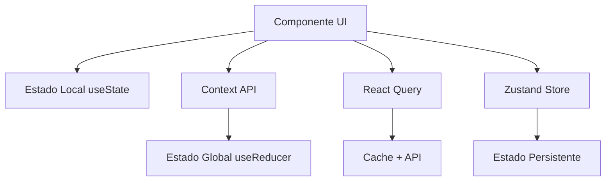

# 📚 Módulo 7: Gerenciamento de Estado para Desenvolvedores C#

## 🎯 Objetivos deste Módulo

- Entender diferentes tipos de estado
- Dominar React Query (TanStack Query)
- Aprender Zustand para estado global
- Usar Context API para estado compartilhado
- Gerenciar cache e sincronização
- Ver exemplos práticos do projeto real

## 📖 Tipos de Estado

### Estado Local vs Global

| Tipo | Onde Usar | Exemplo | Biblioteca |
|------|-----------|---------|------------|
| **Local** | Componente específico | Formulário, modal aberto | `useState` |
| **Global** | Toda aplicação | Usuário logado, tema | `Context` + `useReducer` |
| **Servidor** | Dados da API | Produtos, usuários | `React Query` |
| **Cache** | Dados temporários | Configurações, preferências | `Zustand` |

### Fluxo de Estado Típico



## 🌟 React Query (TanStack Query)

React Query é a **melhor biblioteca** para gerenciar estado de servidor (dados da API).

### Instalação e Configuração

```bash
npm install @tanstack/react-query @tanstack/react-query-devtools
```

```tsx
// Configuração básica
import { QueryClient, QueryClientProvider } from '@tanstack/react-query';

const queryClient = new QueryClient({
  defaultOptions: {
    queries: {
      staleTime: 5 * 60 * 1000, // 5 minutos
      retry: 3,
      refetchOnWindowFocus: false,
    },
    mutations: {
      retry: 1,
    },
  },
});

function App() {
  return (
    <QueryClientProvider client={queryClient}>
      <MyApp />
    </QueryClientProvider>
  );
}
```

### Queries Básicas

```tsx
// Hook básico para buscar dados
function useUsers() {
  return useQuery({
    queryKey: ['users'], // Cache key
    queryFn: () => fetch('/api/users').then(res => res.json()),
    staleTime: 5 * 60 * 1000, // 5 minutos
    refetchInterval: 30 * 1000, // Refetch a cada 30s
  });
}

// Usando no componente
function UserList() {
  const { data: users, isLoading, error, refetch } = useUsers();

  if (isLoading) return <div>Carregando...</div>;
  if (error) return <div>Erro: {error.message}</div>;

  return (
    <div>
      <button onClick={() => refetch()}>Atualizar</button>
      {users?.map(user => (
        <div key={user.id}>{user.name}</div>
      ))}
    </div>
  );
}
```

### Mutations (Criar/Atualizar/Deletar)

```tsx
// Hook para mutations
function useCreateUser() {
  const queryClient = useQueryClient();

  return useMutation({
    mutationFn: (newUser: CreateUserDto) =>
      fetch('/api/users', {
        method: 'POST',
        body: JSON.stringify(newUser),
        headers: { 'Content-Type': 'application/json' }
      }).then(res => res.json()),

    onSuccess: (data) => {
      // Invalidate queries relacionadas
      queryClient.invalidateQueries({ queryKey: ['users'] });

      // Atualizar cache diretamente (opcional)
      queryClient.setQueryData(['users'], (old: User[] | undefined) => {
        return old ? [...old, data] : [data];
      });
    },

    onError: (error) => {
      console.error('Erro ao criar usuário:', error);
    }
  });
}

// Usando mutation
function CreateUserForm() {
  const [name, setName] = useState('');
  const createUser = useCreateUser();

  const handleSubmit = (e: React.FormEvent) => {
    e.preventDefault();
    createUser.mutate({ name, email: `${name}@email.com` });
  };

  return (
    <form onSubmit={handleSubmit}>
      <input
        value={name}
        onChange={(e) => setName(e.target.value)}
        placeholder="Nome"
      />
      <button type="submit" disabled={createUser.isPending}>
        {createUser.isPending ? 'Criando...' : 'Criar'}
      </button>
    </form>
  );
}
```

**Equivalente em C#:**
```csharp
// C# - Repository Pattern + EF Core
public class UserRepository {
  private readonly AppDbContext _context;

  public async Task<User> CreateUserAsync(CreateUserDto dto) {
    var user = new User { Name = dto.Name, Email = dto.Email };
    _context.Users.Add(user);
    await _context.SaveChangesAsync();
    return user;
  }

  public async Task<List<User>> GetUsersAsync() {
    return await _context.Users.ToListAsync();
  }
}
```

## 💾 Zustand - Estado Global Simples

Zustand é uma biblioteca **leve e simples** para estado global, alternativa ao Redux.

### Instalação

```bash
npm install zustand
```

### Store Básico

```tsx
// Criando store
import { create } from 'zustand';

interface UserStore {
  user: User | null;
  isLoading: boolean;
  error: string | null;

  // Actions
  setUser: (user: User) => void;
  clearUser: () => void;
  setLoading: (loading: boolean) => void;
  setError: (error: string | null) => void;
}

export const useUserStore = create<UserStore>((set) => ({
  user: null,
  isLoading: false,
  error: null,

  setUser: (user) => set({ user, error: null }),
  clearUser: () => set({ user: null, error: null }),
  setLoading: (isLoading) => set({ isLoading }),
  setError: (error) => set({ error, isLoading: false }),
}));
```

### Store Avançado com Middleware

```tsx
// Store com persistência e devtools
import { create } from 'zustand';
import { persist } from 'zustand/middleware';
import { devtools } from 'zustand/middleware';

interface ThemeStore {
  theme: 'light' | 'dark';
  setTheme: (theme: 'light' | 'dark') => void;
  toggleTheme: () => void;
}

export const useThemeStore = create<ThemeStore>()(
  devtools(
    persist(
      (set, get) => ({
        theme: 'light',

        setTheme: (theme) => set({ theme }),
        toggleTheme: () => set((state) => ({
          theme: state.theme === 'light' ? 'dark' : 'light'
        })),
      }),
      {
        name: 'theme-storage', // localStorage key
        partialize: (state) => ({ theme: state.theme }), // só persistir theme
      }
    ),
    {
      name: 'theme-store', // devtools name
    }
  )
);
```

### Usando Store no Componente

```tsx
function ThemeToggle() {
  const { theme, toggleTheme } = useThemeStore();

  return (
    <button
      onClick={toggleTheme}
      className={`px-4 py-2 rounded-lg ${
        theme === 'dark'
          ? 'bg-gray-800 text-white'
          : 'bg-white text-gray-800'
      }`}
    >
      {theme === 'light' ? '🌙 Dark' : '☀️ Light'}
    </button>
  );
}

function App() {
  const theme = useThemeStore((state) => state.theme);

  return (
    <div className={theme === 'dark' ? 'dark' : ''}>
      <ThemeToggle />
      <MainContent />
    </div>
  );
}
```

## 🎯 Context API Avançado

### Context com useReducer

```tsx
// Tipos
type AuthAction =
  | { type: 'LOGIN_START' }
  | { type: 'LOGIN_SUCCESS'; payload: User }
  | { type: 'LOGIN_ERROR'; payload: string }
  | { type: 'LOGOUT' };

interface AuthState {
  user: User | null;
  isLoading: boolean;
  error: string | null;
  isAuthenticated: boolean;
}

// Reducer
function authReducer(state: AuthState, action: AuthAction): AuthState {
  switch (action.type) {
    case 'LOGIN_START':
      return { ...state, isLoading: true, error: null };

    case 'LOGIN_SUCCESS':
      return {
        ...state,
        user: action.payload,
        isLoading: false,
        error: null,
        isAuthenticated: true
      };

    case 'LOGIN_ERROR':
      return {
        ...state,
        user: null,
        isLoading: false,
        error: action.payload,
        isAuthenticated: false
      };

    case 'LOGOUT':
      return {
        user: null,
        isLoading: false,
        error: null,
        isAuthenticated: false
      };

    default:
      return state;
  }
}

// Context
const AuthContext = createContext<{
  state: AuthState;
  dispatch: React.Dispatch<AuthAction>;
  login: (email: string, password: string) => Promise<void>;
  logout: () => void;
} | undefined>(undefined);

// Provider
function AuthProvider({ children }: { children: React.ReactNode }) {
  const [state, dispatch] = useReducer(authReducer, {
    user: null,
    isLoading: false,
    error: null,
    isAuthenticated: false
  });

  const login = async (email: string, password: string) => {
    dispatch({ type: 'LOGIN_START' });

    try {
      const response = await fetch('/api/auth/login', {
        method: 'POST',
        body: JSON.stringify({ email, password }),
        headers: { 'Content-Type': 'application/json' }
      });

      if (!response.ok) throw new Error('Login falhou');

      const user = await response.json();
      dispatch({ type: 'LOGIN_SUCCESS', payload: user });
    } catch (error) {
      dispatch({
        type: 'LOGIN_ERROR',
        payload: error instanceof Error ? error.message : 'Erro desconhecido'
      });
    }
  };

  const logout = () => {
    dispatch({ type: 'LOGOUT' });
  };

  return (
    <AuthContext.Provider value={{ state, dispatch, login, logout }}>
      {children}
    </AuthContext.Provider>
  );
}

// Hook customizado
function useAuth() {
  const context = useContext(AuthContext);
  if (!context) throw new Error('useAuth must be used within AuthProvider');
  return context;
}
```

## 🔄 Sincronização e Cache

### Cache Inteligente com React Query

```tsx
// Cache com invalidação automática
function usePosts() {
  const queryClient = useQueryClient();

  const { data: posts } = useQuery({
    queryKey: ['posts'],
    queryFn: () => fetchPosts(),
    staleTime: 5 * 60 * 1000,
  });

  const createPost = useMutation({
    mutationFn: createPostAPI,
    onSuccess: (newPost) => {
      // Otimistic update
      queryClient.setQueryData(['posts'], (old: Post[] | undefined) => {
        return old ? [newPost, ...old] : [newPost];
      });

      // Invalidate após sucesso
      queryClient.invalidateQueries({ queryKey: ['posts'] });
    },
  });

  return { posts, createPost };
}
```

### Background Refetch

```tsx
// Refetch em background
const { data: user } = useQuery({
  queryKey: ['user', userId],
  queryFn: () => fetchUser(userId),
  staleTime: 5 * 60 * 1000, // 5 minutos
  refetchInterval: 30 * 1000, // Refetch a cada 30s
  refetchIntervalInBackground: true, // Continua refetchando em background
  refetchOnWindowFocus: true, // Refetch quando janela ganha foco
});
```

## 🎪 Combinação de Bibliotecas

### React Query + Zustand

```tsx
// Store para UI state (Zustand)
interface UIStore {
  sidebarOpen: boolean;
  modalOpen: boolean;
  selectedUser: User | null;

  // Actions
  toggleSidebar: () => void;
  openModal: (modal: string) => void;
  closeModal: (modal: string) => void;
  setSelectedUser: (user: User | null) => void;
}

export const useUIStore = create<UIStore>((set) => ({
  sidebarOpen: false,
  modalOpen: false,
  selectedUser: null,

  toggleSidebar: () => set((state) => ({ sidebarOpen: !state.sidebarOpen })),
  openModal: (modal) => set({ modalOpen: true }),
  closeModal: (modal) => set({ modalOpen: false }),
  setSelectedUser: (user) => set({ selectedUser: user }),
}));

// Server state (React Query)
function useUsersWithActions() {
  const queryClient = useQueryClient();
  const { selectedUser, setSelectedUser } = useUIStore();

  const { data: users, isLoading } = useQuery({
    queryKey: ['users'],
    queryFn: fetchUsers,
  });

  const updateUser = useMutation({
    mutationFn: updateUserAPI,
    onSuccess: (updatedUser) => {
      queryClient.invalidateQueries({ queryKey: ['users'] });

      // Atualizar UI state se necessário
      if (selectedUser?.id === updatedUser.id) {
        setSelectedUser(updatedUser);
      }
    },
  });

  return {
    users,
    isLoading,
    updateUser,
    selectedUser,
    setSelectedUser
  };
}
```

## 📦 Exemplos do Projeto Real

### 1. React Query - Treinamentos

```tsx
// front/src/hooks/use-training-courses.ts
export const useTrainingCourses = (filters?: TrainingCourseFilters) => {
  const { toast } = useToast();
  const queryClient = useQueryClient();

  // Query para buscar cursos
  const {
    data: courses = [],
    isLoading,
    error,
    refetch,
  } = useQuery({
    queryKey: ['training-courses', filters],
    queryFn: () => trainingService.getCourses(filters),
    staleTime: 5 * 60 * 1000, // 5 minutos
  });

  // Mutation para criar curso
  const createCourseMutation = useMutation({
    mutationFn: (course: CreateTrainingCourseDto) => trainingService.createCourse(course),
    onSuccess: (response) => {
      queryClient.invalidateQueries({ queryKey: ['training-courses'] });
      const responseData = response as { course?: TrainingCourse; message?: string };
      const courseData = responseData.course || response;
      const message = responseData.message || `O curso "${courseData.title}" foi criado com sucesso.`;

      toast({
        title: 'Curso criado!',
        description: message,
      });
    },
    onError: (error: unknown) => {
      const errorMessage = error instanceof Error ? error.message : 'Erro inesperado ao criar curso.';
      toast({
        title: 'Erro ao criar curso',
        description: errorMessage,
        variant: 'destructive',
      });
    },
  });

  // Mutation para atualizar curso
  const updateCourseMutation = useMutation({
    mutationFn: ({ id, course }: { id: string; course: UpdateTrainingCourseDto }) =>
      trainingService.updateCourse(id, course),
    onSuccess: (updatedCourse) => {
      queryClient.invalidateQueries({ queryKey: ['training-courses'] });
      queryClient.invalidateQueries({ queryKey: ['training-course', updatedCourse.id] });
      toast({
        title: 'Curso atualizado!',
        description: `O curso "${updatedCourse.title}" foi atualizado com sucesso.`,
      });
    },
    onError: (error: unknown) => {
      const errorMessage = error instanceof Error ? error.message : 'Erro inesperado ao atualizar curso.';
      toast({
        title: 'Erro ao atualizar curso',
        description: errorMessage,
        variant: 'destructive',
      });
    },
  });

  // Mutation para deletar curso
  const deleteCourseMutation = useMutation({
    mutationFn: (id: string) => trainingService.deleteCourse(id),
    onSuccess: () => {
      queryClient.invalidateQueries({ queryKey: ['training-courses'] });
      toast({
        title: 'Curso deletado!',
        description: 'O curso foi deletado com sucesso.',
      });
    },
    onError: (error: unknown) => {
      const errorMessage = error instanceof Error ? error.message : 'Erro inesperado ao deletar curso.';
      toast({
        title: 'Erro ao deletar curso',
        description: errorMessage,
        variant: 'destructive',
      });
    },
  });

  return {
    courses,
    isLoading,
    error,
    refetch,
    createCourse: createCourseMutation.mutate,
    updateCourse: updateCourseMutation.mutate,
    deleteCourse: deleteCourseMutation.mutate,
    isCreating: createCourseMutation.isPending,
    isUpdating: updateCourseMutation.isPending,
    isDeleting: deleteCourseMutation.isPending,
  };
};
```

### 2. Zustand - Chat Store

```tsx
// front/src/store/chat-store.ts
interface ChatState {
  // Status de digitação por chat
  byChat: Record<string, boolean>
  // Último timestamp de leitura por chat
  lastReadAtByChat: Record<string, string>
  // Cache de chats para deduplicação
  chatsCache: Map<string, ChatListItem>
  // Cache de mensagens para deduplicação
  messagesCache: Map<string, Set<string>> // chatId -> Set<messageId>

  // Novas funcionalidades para conversas
  conversations: Record<string, ConversationUI>;
  botStatus: BotStatus;

  // Ações existentes
  setTyping: (chatId: string, isTyping: boolean) => void
  setLastReadAt: (chatId: string, timestamp: string) => void
  addChat: (chat: ChatListItem) => void
  updateChat: (chatId: string, updates: Partial<ChatListItem>) => void
  addMessage: (chatId: string, message: ChatMessageDto) => boolean
  clearCache: () => void

  // Novas ações para conversas
  upsertConversation: (c: Partial<ConversationUI> & { conversationId: string }) => void;
  appendInbound: (conversationId: string, msg: MessageDto) => void;
  markOutboundStatus: (conversationId: string, clientMessageId: string, status: 'sent' | 'failed', externalMessageId?: string) => void;
  updateBotStatus: (status: BotStatus) => void;
}

export const useChatStore = create<ChatState>((set, get) => ({
  byChat: {},
  lastReadAtByChat: {},
  chatsCache: new Map(),
  messagesCache: new Map(),

  conversations: {},
  botStatus: {
    online: false,
    validated: false,
    lastUpdate: new Date().toISOString()
  },

  setTyping: (chatId, isTyping) => set(state => ({
    byChat: {
      ...state.byChat,
      [chatId]: isTyping
    }
  })),

  setLastReadAt: (chatId, timestamp) => set(state => ({
    lastReadAtByChat: {
      ...state.lastReadAtByChat,
      [chatId]: timestamp
    }
  })),

  addChat: (chat) => set(state => {
    const newCache = new Map(state.chatsCache);
    newCache.set(chat.id, chat);
    return { chatsCache: newCache };
  }),

  addMessage: (chatId, message) => {
    const state = get();
    const messageIds = state.messagesCache.get(chatId) || new Set();

    // Verificar se a mensagem já existe para evitar duplicação
    if (messageIds.has(message.id)) {
      console.log(`🔧 Mensagem duplicada ignorada: ${message.id} em chat ${chatId}`);
      return false;
    }

    // Adicionar mensagem ao cache
    messageIds.add(message.id);
    const newMessagesCache = new Map(state.messagesCache);
    newMessagesCache.set(chatId, messageIds);

    set({ messagesCache: newMessagesCache });
    console.log(`🔧 Mensagem adicionada ao cache: ${message.id} em chat ${chatId}`);
    return true;
  },

  clearCache: () => set({
    chatsCache: new Map(),
    messagesCache: new Map()
  }),

  // Ações para conversas
  upsertConversation: (c) => set((s) => {
    const prev = s.conversations[c.conversationId];
    const base: ConversationUI = prev ?? {
      conversationId: c.conversationId,
      peerE164: c.peerE164 ?? '',
      isGroup: !!c.isGroup,
      title: c.title ?? null,
      currentSessionId: c.currentSessionId ?? null,
      lastMessageAt: c.lastMessageAt ?? undefined,
      messages: [],
      messagesMap: {},
      isWhatsApp: c.isWhatsApp ?? true
    };
    const next: ConversationUI = {
      ...base,
      ...c,
      messages: base.messages,
      messagesMap: base.messagesMap,
    };
    return {
      conversations: {
        ...s.conversations,
        [c.conversationId]: next
      }
    };
  }),

  appendInbound: (conversationId, msg) => set((s) => {
    const conv = s.conversations[conversationId];
    if (!conv) return s;

    const extId = msg.externalMessageId ?? '';
    if (extId && conv.messagesMap[extId]) return s;

    const messages = conv.messages.slice();
    messages.push(msg);

    const messagesMap = { ...conv.messagesMap };
    if (extId) messagesMap[extId] = true;

    const lastMessageAt = msg.ts ?? msg.createdAt ?? conv.lastMessageAt;

    return {
      conversations: {
        ...s.conversations,
        [conversationId]: {
          ...conv,
          messages,
          messagesMap,
          lastMessageAt,
        },
      },
    };
  }),

  updateBotStatus: (status) => set(() => ({
    botStatus: status
  }))
}))
```

### 3. Context API - Auth Permissions

```tsx
// front/src/contexts/AuthPermissionsContext.tsx
export interface AuthPermissionsContextType {
  user: UserData | null;
  role: string | null;
  isLoading: boolean;
  error: string | null;

  // Funções de verificação de permissão
  hasPermission: (permission: Permission) => boolean;
  hasAllPermissions: (permissions: Permission[]) => boolean;
  hasAnyPermission: (permissions: Permission[]) => boolean;

  // Helpers de role
  isAdmin: boolean;
  isInstructor: boolean;
  isOperator: boolean;
  isProducer: boolean;
  isModel: boolean;
  isStudent: boolean;

  // Função para recarregar dados do usuário
  refetch: () => Promise<void>;
}

export const AuthPermissionsProvider: React.FC<AuthPermissionsProviderProps> = ({ children }) => {
  const { user: clerkUser, isLoaded: isClerkLoaded, isSignedIn } = useUser();
  const [user, setUser] = useState<UserData | null>(null);
  const [isLoading, setIsLoading] = useState(true);
  const [error, setError] = useState<string | null>(null);

  const fetchUserData = useCallback(async () => {
    if (!isSignedIn || !clerkUser) {
      setUser(null);
      setIsLoading(false);
      return;
    }

    try {
      setIsLoading(true);
      setError(null);

      const email = clerkUser.primaryEmailAddress?.emailAddress;

      if (!email) {
        console.warn('[AuthPermissions] Email não encontrado no Clerk - modo degradado');
        setUser(null);
        setIsLoading(false);
        return;
      }

      const response = await apiClient.get<UserData>(`/api/Users/by-email/${encodeURIComponent(email)}`);

      setUser(response);
      setError(null);
    } catch (err) {
      console.warn('[AuthPermissions] Usuário não encontrado no banco de dados, permitindo acesso em modo degradado');
      setUser(null);
      setError(null);
    } finally {
      setIsLoading(false);
    }
  }, [isSignedIn, clerkUser]);

  useEffect(() => {
    if (isClerkLoaded) {
      fetchUserData();
    }
  }, [isClerkLoaded, fetchUserData]);

  // Funções de verificação de permissão
  const checkPermission = useCallback((permission: Permission): boolean => {
    if (!role) return false;
    return hasPermission(role, permission);
  }, [role]);

  const checkAllPermissions = useCallback((permissions: Permission[]): boolean => {
    if (!role) return false;
    return hasAllPermissions(role, permissions);
  }, [role]);

  const checkAnyPermission = useCallback((permissions: Permission[]): boolean => {
    if (!role) return false;
    return hasAnyPermission(role, permissions);
  }, [role]);

  // Helpers de role
  const isAdmin = role === UserRole.ADMIN;
  const isInstructor = role === UserRole.INSTRUCTOR;
  const isOperator = role === UserRole.OPERATOR;
  const isProducer = role === UserRole.PRODUCER;
  const isModel = role === UserRole.MODEL;
  const isStudent = role === UserRole.STUDENT;

  const value: AuthPermissionsContextType = {
    user,
    role,
    isLoading,
    error,
    hasPermission: checkPermission,
    hasAllPermissions: checkAllPermissions,
    hasAnyPermission: checkAnyPermission,
    isAdmin,
    isInstructor,
    isOperator,
    isProducer,
    isModel,
    isStudent,
    refetch: fetchUserData,
  };

  return (
    <AuthPermissionsContext.Provider value={value}>
      {children}
    </AuthPermissionsContext.Provider>
  );
};
```

### 4. Configuração React Query

```tsx
// front/src/components/root-app.tsx
const queryClient = new QueryClient({
  defaultOptions: {
    queries: {
      staleTime: 60 * 1000, // 1 minuto
      retry: 1,
    },
  },
});

export function RootApp({ children }: RootAppProps = {}) {
  return (
    <QueryClientProvider client={queryClient}>
      <ThemeProvider attribute="class" defaultTheme="light" enableSystem>
        <App />
        <Toaster />
        {children}
      </ThemeProvider>
    </QueryClientProvider>
  );
}
```

## 🧪 Exercícios Práticos

### Exercício 1: E-commerce com Múltiplos Estados

```tsx
// Criar um sistema de e-commerce completo
interface Product {
  id: number;
  name: string;
  price: number;
  category: string;
  inStock: boolean;
  image: string;
}

interface CartItem {
  product: Product;
  quantity: number;
}

interface User {
  id: number;
  name: string;
  email: string;
  addresses: Address[];
}

interface Address {
  id: number;
  street: string;
  city: string;
  zipCode: string;
}

// 1. Store do Carrinho (Zustand)
interface CartStore {
  items: CartItem[];
  total: number;
  discount: number;

  addItem: (product: Product, quantity?: number) => void;
  removeItem: (productId: number) => void;
  updateQuantity: (productId: number, quantity: number) => void;
  clearCart: () => void;
  applyDiscount: (code: string) => void;
}

export const useCartStore = create<CartStore>((set, get) => ({
  items: [],
  total: 0,
  discount: 0,

  addItem: (product, quantity = 1) => set((state) => {
    const existingItem = state.items.find(item => item.product.id === product.id);

    if (existingItem) {
      return {
        items: state.items.map(item =>
          item.product.id === product.id
            ? { ...item, quantity: item.quantity + quantity }
            : item
        ),
        total: state.total + (product.price * quantity)
      };
    }

    return {
      items: [...state.items, { product, quantity }],
      total: state.total + (product.price * quantity)
    };
  }),

  removeItem: (productId) => set((state) => {
    const item = state.items.find(item => item.product.id === productId);
    if (!item) return state;

    return {
      items: state.items.filter(item => item.product.id !== productId),
      total: state.total - (item.product.price * item.quantity)
    };
  }),

  updateQuantity: (productId, quantity) => set((state) => {
    if (quantity <= 0) return get().removeItem(productId);

    const item = state.items.find(item => item.product.id === productId);
    if (!item) return state;

    const diff = quantity - item.quantity;

    return {
      items: state.items.map(item =>
        item.product.id === productId
          ? { ...item, quantity }
          : item
      ),
      total: state.total + (item.product.price * diff)
    };
  }),

  clearCart: () => set({ items: [], total: 0, discount: 0 }),

  applyDiscount: (code) => set((state) => {
    const discountPercentage = code === 'SAVE10' ? 0.1 : 0;
    return {
      discount: state.total * discountPercentage
    };
  }),
}));

// 2. Store do Usuário (Zustand com persistência)
interface UserStore {
  user: User | null;
  selectedAddress: Address | null;
  isLoading: boolean;

  login: (email: string, password: string) => Promise<void>;
  logout: () => void;
  setSelectedAddress: (address: Address) => void;
  addAddress: (address: Address) => void;
}

export const useUserStore = create<UserStore>()(
  persist(
    (set, get) => ({
      user: null,
      selectedAddress: null,
      isLoading: false,

      login: async (email, password) => {
        set({ isLoading: true });
        try {
          const response = await fetch('/api/auth/login', {
            method: 'POST',
            body: JSON.stringify({ email, password }),
            headers: { 'Content-Type': 'application/json' }
          });

          if (!response.ok) throw new Error('Login falhou');

          const user = await response.json();
          set({ user, isLoading: false });
        } catch (error) {
          set({ user: null, isLoading: false });
          throw error;
        }
      },

      logout: () => set({ user: null, selectedAddress: null }),

      setSelectedAddress: (address) => set({ selectedAddress: address }),

      addAddress: (address) => set((state) => {
        if (!state.user) return state;

        return {
          user: {
            ...state.user,
            addresses: [...state.user.addresses, address]
          }
        };
      }),
    }),
    {
      name: 'user-storage',
      partialize: (state) => ({ user: state.user, selectedAddress: state.selectedAddress }),
    }
  )
);

// 3. Hooks para API (React Query)
function useProducts() {
  return useQuery({
    queryKey: ['products'],
    queryFn: () => fetch('/api/products').then(res => res.json()),
    staleTime: 5 * 60 * 1000,
  });
}

function useCategories() {
  return useQuery({
    queryKey: ['categories'],
    queryFn: () => fetch('/api/categories').then(res => res.json()),
    staleTime: 10 * 60 * 1000, // Categorias mudam menos
  });
}

// 4. Componente principal
function ECommerceApp() {
  const { items, total, discount, addItem, removeItem, updateQuantity, clearCart } = useCartStore();
  const { user, selectedAddress } = useUserStore();
  const { data: products = [], isLoading: productsLoading } = useProducts();
  const { data: categories = [] } = useCategories();

  if (productsLoading) return <div>Carregando produtos...</div>;

  return (
    <div className="ecommerce-app">
      {/* Header com carrinho */}
      <header className="flex justify-between items-center p-4 bg-white shadow">
        <h1>Minha Loja</h1>
        <div className="flex items-center gap-4">
          {user && <span>Olá, {user.name}!</span>}
          <div className="relative">
            <button className="relative">
              🛒 ({items.length})
              {items.length > 0 && (
                <span className="absolute -top-2 -right-2 bg-red-500 text-white rounded-full w-5 h-5 text-xs flex items-center justify-center">
                  {items.length}
                </span>
              )}
            </button>
          </div>
        </div>
      </header>

      {/* Produtos */}
      <main className="p-4">
        <div className="grid grid-cols-1 md:grid-cols-2 lg:grid-cols-3 xl:grid-cols-4 gap-4">
          {products.map(product => (
            <ProductCard
              key={product.id}
              product={product}
              onAddToCart={() => addItem(product)}
            />
          ))}
        </div>
      </main>

      {/* Carrinho lateral */}
      {items.length > 0 && (
        <div className="fixed right-0 top-0 h-full w-96 bg-white shadow-lg transform translate-x-0 transition-transform">
          <div className="p-4">
            <div className="flex justify-between items-center mb-4">
              <h2>Carrinho</h2>
              <button onClick={clearCart}>Limpar</button>
            </div>

            <div className="space-y-2 mb-4">
              {items.map(item => (
                <div key={item.product.id} className="flex justify-between items-center border-b pb-2">
                  <div>
                    <h3 className="font-medium">{item.product.name}</h3>
                    <p className="text-sm text-gray-600">R$ {item.product.price.toFixed(2)}</p>
                  </div>
                  <div className="flex items-center gap-2">
                    <button onClick={() => updateQuantity(item.product.id, item.quantity - 1)}>
                      -
                    </button>
                    <span>{item.quantity}</span>
                    <button onClick={() => updateQuantity(item.product.id, item.quantity + 1)}>
                      +
                    </button>
                    <button onClick={() => removeItem(item.product.id)}>✕</button>
                  </div>
                </div>
              ))}
            </div>

            <div className="border-t pt-4">
              <div className="flex justify-between mb-2">
                <span>Subtotal:</span>
                <span>R$ {total.toFixed(2)}</span>
              </div>
              {discount > 0 && (
                <div className="flex justify-between mb-2 text-green-600">
                  <span>Desconto:</span>
                  <span>-R$ {discount.toFixed(2)}</span>
                </div>
              )}
              <div className="flex justify-between font-bold">
                <span>Total:</span>
                <span>R$ {(total - discount).toFixed(2)}</span>
              </div>

              <button className="w-full bg-blue-500 text-white py-2 rounded-lg mt-4">
                Finalizar Compra
              </button>
            </div>
          </div>
        </div>
      )}
    </div>
  );
}
```

### Exercício 2: Sistema de Notificações

```tsx
// Criar um sistema de notificações com diferentes tipos de estado
import { create } from 'zustand';
import { persist } from 'zustand/middleware';

interface Notification {
  id: string;
  type: 'success' | 'error' | 'warning' | 'info';
  title: string;
  message?: string;
  timestamp: number;
  read: boolean;
  action?: {
    label: string;
    onClick: () => void;
  };
}

interface NotificationStore {
  notifications: Notification[];
  unreadCount: number;

  addNotification: (notification: Omit<Notification, 'id' | 'timestamp' | 'read'>) => void;
  markAsRead: (id: string) => void;
  markAllAsRead: () => void;
  removeNotification: (id: string) => void;
  clearAll: () => void;
}

export const useNotificationStore = create<NotificationStore>()(
  persist(
    (set, get) => ({
      notifications: [],
      unreadCount: 0,

      addNotification: (notification) => set((state) => {
        const newNotification: Notification = {
          ...notification,
          id: Date.now().toString(),
          timestamp: Date.now(),
          read: false
        };

        return {
          notifications: [newNotification, ...state.notifications],
          unreadCount: state.unreadCount + 1
        };
      }),

      markAsRead: (id) => set((state) => ({
        notifications: state.notifications.map(notif =>
          notif.id === id ? { ...notif, read: true } : notif
        ),
        unreadCount: Math.max(0, state.unreadCount - 1)
      })),

      markAllAsRead: () => set((state) => ({
        notifications: state.notifications.map(notif => ({ ...notif, read: true })),
        unreadCount: 0
      })),

      removeNotification: (id) => set((state) => {
        const notification = state.notifications.find(n => n.id === id);
        const wasUnread = notification && !notification.read;

        return {
          notifications: state.notifications.filter(n => n.id !== id),
          unreadCount: wasUnread ? state.unreadCount - 1 : state.unreadCount
        };
      }),

      clearAll: () => set({ notifications: [], unreadCount: 0 }),
    }),
    {
      name: 'notifications-storage',
      partialize: (state) => ({
        notifications: state.notifications,
        unreadCount: state.unreadCount
      }),
    }
  )
);

// Hook para API com cache
function useApiWithNotifications<T>(url: string) {
  const { addNotification } = useNotificationStore();

  const query = useQuery({
    queryKey: [url],
    queryFn: () => fetch(url).then(res => res.json()),
    onError: (error) => {
      addNotification({
        type: 'error',
        title: 'Erro na API',
        message: error instanceof Error ? error.message : 'Erro desconhecido'
      });
    },
    onSuccess: () => {
      addNotification({
        type: 'success',
        title: 'Dados atualizados',
        message: 'Informações carregadas com sucesso'
      });
    }
  });

  return query;
}

// Componente de lista de notificações
function NotificationList() {
  const { notifications, markAsRead, removeNotification, clearAll } = useNotificationStore();

  return (
    <div className="notification-list">
      <div className="flex justify-between items-center mb-4">
        <h2>Notificações</h2>
        {notifications.length > 0 && (
          <button onClick={clearAll} className="text-sm text-gray-500">
            Limpar todas
          </button>
        )}
      </div>

      <div className="space-y-2">
        {notifications.length === 0 ? (
          <p className="text-gray-500 text-center py-4">Nenhuma notificação</p>
        ) : (
          notifications.map(notification => (
            <div
              key={notification.id}
              className={`p-3 rounded-lg border-l-4 ${
                notification.read
                  ? 'bg-gray-50 border-gray-300'
                  : 'bg-white border-blue-500'
              }`}
            >
              <div className="flex justify-between items-start">
                <div className="flex-1">
                  <div className="flex items-center gap-2">
                    <span className={`w-2 h-2 rounded-full ${
                      notification.type === 'success' ? 'bg-green-500' :
                      notification.type === 'error' ? 'bg-red-500' :
                      notification.type === 'warning' ? 'bg-yellow-500' : 'bg-blue-500'
                    }`} />
                    <h4 className="font-medium">{notification.title}</h4>
                    {!notification.read && (
                      <span className="w-2 h-2 bg-blue-500 rounded-full"></span>
                    )}
                  </div>
                  {notification.message && (
                    <p className="text-sm text-gray-600 mt-1">{notification.message}</p>
                  )}
                  <p className="text-xs text-gray-400 mt-1">
                    {new Date(notification.timestamp).toLocaleString()}
                  </p>
                </div>

                <div className="flex gap-1">
                  {!notification.read && (
                    <button
                      onClick={() => markAsRead(notification.id)}
                      className="text-xs text-blue-500 hover:text-blue-700"
                    >
                      Marcar como lida
                    </button>
                  )}
                  <button
                    onClick={() => removeNotification(notification.id)}
                    className="text-xs text-gray-400 hover:text-gray-600"
                  >
                    ✕
                  </button>
                </div>
              </div>

              {notification.action && (
                <button
                  onClick={notification.action.onClick}
                  className="mt-2 text-sm bg-blue-500 text-white px-3 py-1 rounded hover:bg-blue-600"
                >
                  {notification.action.label}
                </button>
              )}
            </div>
          ))
        )}
      </div>
    </div>
  );
}
```

### Exercício 3: Dashboard com Estado Sincronizado

```tsx
// Criar um dashboard que sincroniza dados em tempo real
interface DashboardState {
  metrics: {
    users: number;
    orders: number;
    revenue: number;
    growth: number;
  };
  lastUpdated: string;
  isRealTime: boolean;

  setMetrics: (metrics: Partial<DashboardState['metrics']>) => void;
  toggleRealTime: () => void;
  refreshData: () => Promise<void>;
}

export const useDashboardStore = create<DashboardState>((set, get) => ({
  metrics: {
    users: 0,
    orders: 0,
    revenue: 0,
    growth: 0
  },
  lastUpdated: new Date().toISOString(),
  isRealTime: false,

  setMetrics: (newMetrics) => set((state) => ({
    metrics: { ...state.metrics, ...newMetrics },
    lastUpdated: new Date().toISOString()
  })),

  toggleRealTime: () => set((state) => ({
    isRealTime: !state.isRealTime
  })),

  refreshData: async () => {
    try {
      const response = await fetch('/api/dashboard/metrics');
      if (response.ok) {
        const data = await response.json();
        get().setMetrics(data);
      }
    } catch (error) {
      console.error('Erro ao atualizar métricas:', error);
    }
  }
}));

// Hook para métricas com React Query
function useDashboardMetrics() {
  const { setMetrics, isRealTime } = useDashboardStore();

  return useQuery({
    queryKey: ['dashboard-metrics'],
    queryFn: () => fetch('/api/dashboard/metrics').then(res => res.json()),
    staleTime: isRealTime ? 0 : 5 * 60 * 1000, // Real-time ou 5 minutos
    refetchInterval: isRealTime ? 30 * 1000 : false, // 30s se real-time
    onSuccess: (data) => {
      setMetrics(data);
    }
  });
}

// Hook para WebSocket updates
function useDashboardWebSocket() {
  const setMetrics = useDashboardStore((state) => state.setMetrics);

  useEffect(() => {
    const ws = new WebSocket('ws://localhost:3001/dashboard');

    ws.onmessage = (event) => {
      const data = JSON.parse(event.data);
      setMetrics(data);
    };

    return () => {
      ws.close();
    };
  }, [setMetrics]);
}

// Componente Dashboard
function Dashboard() {
  const { metrics, lastUpdated, isRealTime, toggleRealTime, refreshData } = useDashboardStore();
  const { data: apiMetrics, isLoading, error } = useDashboardMetrics();

  useDashboardWebSocket(); // Conectar WebSocket

  if (isLoading) return <div>Carregando dashboard...</div>;
  if (error) return <div>Erro: {error.message}</div>;

  return (
    <div className="dashboard">
      <div className="dashboard-header">
        <h1>Dashboard</h1>
        <div className="flex items-center gap-4">
          <button
            onClick={toggleRealTime}
            className={`px-3 py-1 rounded-lg ${
              isRealTime
                ? 'bg-green-500 text-white'
                : 'bg-gray-200 text-gray-700'
            }`}
          >
            {isRealTime ? '🔴 Real-time' : '⚪ Pausado'}
          </button>
          <button onClick={refreshData} className="bg-blue-500 text-white px-3 py-1 rounded-lg">
            🔄 Atualizar
          </button>
        </div>
        <p className="text-sm text-gray-500">
          Última atualização: {new Date(lastUpdated).toLocaleString()}
        </p>
      </div>

      <div className="metrics-grid">
        <MetricCard
          title="Usuários"
          value={metrics.users.toLocaleString()}
          change="+12%"
          icon="👥"
        />
        <MetricCard
          title="Pedidos"
          value={metrics.orders.toLocaleString()}
          change="+8%"
          icon="📦"
        />
        <MetricCard
          title="Receita"
          value={`R$ ${metrics.revenue.toLocaleString()}`}
          change="+15%"
          icon="💰"
        />
        <MetricCard
          title="Crescimento"
          value={`${metrics.growth}%`}
          change="+5%"
          icon="📈"
        />
      </div>

      <div className="charts-section">
        <SalesChart />
        <UserGrowthChart />
        <TopProductsChart />
      </div>
    </div>
  );
}

interface MetricCardProps {
  title: string;
  value: string;
  change: string;
  icon: string;
}

function MetricCard({ title, value, change, icon }: MetricCardProps) {
  return (
    <div className="metric-card bg-white p-6 rounded-lg shadow-md">
      <div className="flex items-center justify-between mb-2">
        <span className="text-2xl">{icon}</span>
        <span className={`text-sm px-2 py-1 rounded ${
          change.startsWith('+')
            ? 'bg-green-100 text-green-700'
            : 'bg-red-100 text-red-700'
        }`}>
          {change}
        </span>
      </div>
      <h3 className="text-gray-600 text-sm mb-1">{title}</h3>
      <p className="text-2xl font-bold">{value}</p>
    </div>
  );
}
```

## 🎯 Pontos Críticos para Desenvolvedores C#

### 1. **Imutabilidade**

```tsx
// ❌ Ruim - mutando estado diretamente
const [users, setUsers] = useState(initialUsers);
setUsers(users.push(newUser)); // Erro! push muta o array

// ✅ Correto - criando novo array
setUsers([...users, newUser]);

// ❌ Ruim - Zustand
const addUser = (user) => set((state) => {
  state.users.push(user); // Mutação!
  return state;
});

// ✅ Correto - Zustand
const addUser = (user) => set((state) => ({
  users: [...state.users, user]
}));
```

### 2. **Performance com Context**

```tsx
// ❌ Ruim - re-renderiza todos os consumidores
function AppContext({ children }) {
  const [state, setState] = useState(largeObject);

  return (
    <MyContext.Provider value={{ state, setState }}>
      {children}
    </MyContext.Provider>
  );
}

// ✅ Correto - useMemo
const contextValue = useMemo(() => ({
  state,
  setState
}), [state]);

<MyContext.Provider value={contextValue}>
```

### 3. **Cache Management**

```tsx
// ❌ Ruim - cache manual complexo
const [cache, setCache] = useState(new Map());

useEffect(() => {
  const cached = cache.get(key);
  if (cached) {
    setData(cached);
    return;
  }

  fetchData().then(result => {
    setCache(new Map(cache.set(key, result)));
    setData(result);
  });
}, [key]);

// ✅ Correto - React Query
const { data } = useQuery({
  queryKey: [key],
  queryFn: fetchData,
  staleTime: 5 * 60 * 1000, // Cache automático
});
```

### 4. **Memory Leaks**

```tsx
// ❌ Ruim - sem cleanup
useEffect(() => {
  const interval = setInterval(() => {
    console.log('tick');
  }, 1000);
  // Memory leak!
}, []);

// ✅ Correto - com cleanup
useEffect(() => {
  const interval = setInterval(() => {
    console.log('tick');
  }, 1000);

  return () => clearInterval(interval);
}, []);
```

## 🏁 Conclusão

Gerenciamento de estado em React envolve **diferentes padrões** para diferentes tipos de dados:

1. **useState/useReducer** - Estado local e lógica complexa
2. **Context API** - Estado compartilhado entre componentes
3. **React Query** - Estado de servidor com cache
4. **Zustand** - Estado global simples e performático
5. **Custom Hooks** - Abstrair lógica reutilizável

## 📚 Próximos Passos

Agora que você domina gerenciamento de estado, está pronto para:

- **Módulo 8:** Implementar roteamento avançado com React Router
- **Módulo 9:** Usar sistema de UI profissional (Shadcn/Radix)
- **Módulo 10:** Integrar autenticação completa

## 🎯 Resumo do que Aprendemos

✅ **useState vs useReducer**
✅ **Context API avançado**
✅ **React Query para API state**
✅ **Zustand para estado global**
✅ **Performance optimization**
✅ **Cache management**
✅ **Real-time updates**
✅ **Exemplos do projeto real**

---

**🎓 Parabéns! Você completou o Módulo 7!**

**Continue para o [Módulo 8: Roteamento com React Router](Modulo-8-Roteamento-React-Router.md)**

