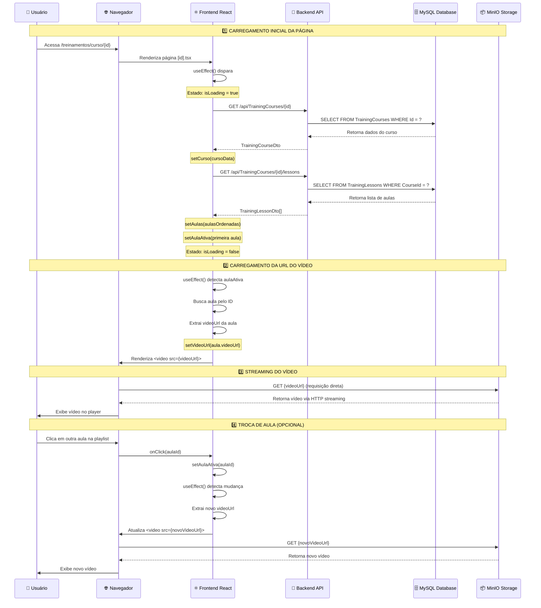

# 🎬 Diagrama de Sequência - Sistema de Vídeo-Aulas

## 📊 Fluxo Completo de Exibição de Vídeo



---

## 🔄 Fluxo de Dados Detalhado

### **Passo 1: Requisição GET Curso**

```
Frontend                        Backend                         Database
   |                               |                                |
   |-- GET /api/TrainingCourses/  -->|                                |
   |   374e3768-4d2a-47db-b6d7-   |                                |
   |   9d472f0ac630                |                                |
   |                               |                                |
   |                               |-- SELECT * FROM              ->|
   |                               |   TrainingCourses             |
   |                               |   WHERE Id = ?                |
   |                               |                                |
   |                               |<-- Retorna 1 registro --------|
   |                               |                                |
   |<-- Retorna JSON --------------|                                |
   |                               |                                |
```

**Response JSON:**
```json
{
  "id": "374e3768-4d2a-47db-b6d7-9d472f0ac630",
  "title": "Testde de curso My Pregiato",
  "description": "...",
  "totalLessons": 2,
  "totalDurationMinutes": 30,
  "isPublished": true
}
```

---

### **Passo 2: Requisição GET Aulas**

```
Frontend                        Backend                         Database
   |                               |                                |
   |-- GET /api/TrainingCourses/  -->|                                |
   |   {id}/lessons                |                                |
   |                               |                                |
   |                               |-- SELECT * FROM              ->|
   |                               |   TrainingLessons             |
   |                               |   WHERE CourseId = ?          |
   |                               |   AND DeletedAt IS NULL       |
   |                               |   ORDER BY OrderIndex         |
   |                               |                                |
   |                               |<-- Retorna N registros -------|
   |                               |                                |
   |<-- Retorna JSON Array --------|                                |
   |                               |                                |
```

**Response JSON:**
```json
[
  {
    "id": "08de0ca5-a403-4fca-8cc3-10791f972a84",
    "courseId": "374e3768-4d2a-47db-b6d7-9d472f0ac630",
    "title": "Apresentação 1",
    "description": "...",
    "orderIndex": 1,
    "videoUrl": "https://bucket-production-1aef.up.railway.app/midias/Course/...",
    "videoObjectName": "Course/.../video.mp4",
    "videoDurationSeconds": 900,
    "isActive": true
  },
  {
    "id": "08de0ca5-a404-4cc2-8829-9f6c23d90d6c",
    "courseId": "374e3768-4d2a-47db-b6d7-9d472f0ac630",
    "title": "Apresentação 2",
    "orderIndex": 2,
    "videoUrl": "https://bucket-production-1aef.up.railway.app/midias/Course/...",
    "isActive": true
  }
]
```

---

### **Passo 3: Streaming do Vídeo**

```
Navegador                                          MinIO Storage
    |                                                    |
    |-- GET https://bucket-production-1aef...     ----->|
    |                                                    |
    |                                                    |-- Verifica permissões
    |                                                    |-- Lê arquivo do disco
    |                                                    |
    |<-- HTTP 200 OK -------------------------------------|
    |    Content-Type: video/mp4                         |
    |    Content-Length: 24881398                        |
    |    Accept-Ranges: bytes                            |
    |                                                    |
    |<-- Stream de bytes (chunked) ---------------------|
    |<-- Chunk 1 (256KB) ------------------------------|
    |<-- Chunk 2 (256KB) ------------------------------|
    |<-- Chunk N (256KB) ------------------------------|
    |                                                    |
```

**Headers HTTP Importantes:**
```
Accept-Ranges: bytes
Content-Type: video/mp4
Content-Length: 24881398
Access-Control-Allow-Origin: *
Cache-Control: public, max-age=31536000
```

---

## 🏗️ Arquitetura de Componentes

```
┌────────────────────────────────────────────────────────────────┐
│                    PÁGINA: curso/[id].tsx                       │
├────────────────────────────────────────────────────────────────┤
│                                                                 │
│  ┌──────────────────────────────────────────────────────────┐ │
│  │  ESTADO (useState)                                        │ │
│  │  • curso: TrainingCourse | null                          │ │
│  │  • aulas: TrainingLesson[]                               │ │
│  │  • aulaAtiva: string                                     │ │
│  │  • videoUrl: string                                      │ │
│  │  • isLoading: boolean                                    │ │
│  │  • error: string | null                                  │ │
│  └──────────────────────────────────────────────────────────┘ │
│                                                                 │
│  ┌──────────────────────────────────────────────────────────┐ │
│  │  EFEITOS (useEffect)                                     │ │
│  │                                                           │ │
│  │  1. [id, user, isUserLoaded] → carregarCurso()          │ │
│  │     • trainingService.getCourseById(id)                 │ │
│  │     • trainingService.getCourseLessons(id)              │ │
│  │     • setAulaAtiva(primeira aula)                       │ │
│  │                                                           │ │
│  │  2. [aulaAtiva, aulas] → carregarVideoUrl()             │ │
│  │     • Busca aula pelo ID                                │ │
│  │     • setVideoUrl(aula.videoUrl)                        │ │
│  └──────────────────────────────────────────────────────────┘ │
│                                                                 │
│  ┌──────────────────────────────────────────────────────────┐ │
│  │  RENDERIZAÇÃO                                            │ │
│  │                                                           │ │
│  │  ┌────────────────────────┐  ┌───────────────────────┐ │ │
│  │  │   PLAYER (70% width)   │  │  PLAYLIST (30% width) │ │ │
│  │  │                        │  │                       │ │ │
│  │  │  ┌──────────────────┐ │  │  ┌─────────────────┐ │ │ │
│  │  │  │  <video>         │ │  │  │ Aula 1 ✓        │ │ │ │
│  │  │  │  src={videoUrl}  │ │  │  │ Aula 2 ▶ [ATIVA]│ │ │ │
│  │  │  │  controls        │ │  │  │ Aula 3          │ │ │ │
│  │  │  │  crossOrigin     │ │  │  └─────────────────┘ │ │ │
│  │  │  └──────────────────┘ │  │                       │ │ │
│  │  │                        │  │  onClick → setAulaAtiva│ │
│  │  │  ┌──────────────────┐ │  │                       │ │ │
│  │  │  │  Título da Aula  │ │  │                       │ │ │
│  │  │  │  Descrição       │ │  │                       │ │ │
│  │  │  │  Duração: 15min  │ │  │                       │ │ │
│  │  │  └──────────────────┘ │  │                       │ │ │
│  │  └────────────────────────┘  └───────────────────────┘ │ │
│  └──────────────────────────────────────────────────────────┘ │
└────────────────────────────────────────────────────────────────┘
```

---

## 🔐 Fluxo de Autenticação (Clerk)

```
┌──────────────┐
│   Usuário    │
└──────┬───────┘
       │
       │ 1. Acessa página
       ▼
┌──────────────────────────┐
│    Clerk.js (Browser)    │
│  • Verifica sessão       │
│  • Gera token JWT        │
└──────┬───────────────────┘
       │
       │ 2. Token no header
       ▼
┌──────────────────────────┐
│   API Client (Axios)     │
│  • Interceptor adiciona  │
│    Authorization: Bearer │
└──────┬───────────────────┘
       │
       │ 3. Requisição com token
       ▼
┌──────────────────────────┐
│  Backend API (.NET)      │
│  • [ClerkAuthorize]      │ ⚠️ DESABILITADO
│  • Valida token          │
│  • Extrai claims         │
└──────┬───────────────────┘
       │
       │ 4. Acesso permitido
       ▼
┌──────────────────────────┐
│   Database / MinIO       │
└──────────────────────────┘
```

---

## 📈 Métricas e Performance

### **Tempo de Carregamento Esperado:**

```
┌─────────────────────────────────┬──────────┐
│ Operação                        │ Tempo    │
├─────────────────────────────────┼──────────┤
│ GET /api/TrainingCourses/{id}   │ ~200ms   │
│ GET /api/TrainingCourses/lessons│ ~300ms   │
│ Renderização React              │ ~100ms   │
│ Início streaming vídeo (MinIO)  │ ~500ms   │
│ ────────────────────────────────┼──────────┤
│ TOTAL ATÉ PRIMEIRO FRAME        │ ~1100ms  │
└─────────────────────────────────┴──────────┘
```

### **Tamanho dos Dados:**

```
┌─────────────────────────────────┬────────────┐
│ Recurso                         │ Tamanho    │
├─────────────────────────────────┼────────────┤
│ TrainingCourseDto (JSON)        │ ~2KB       │
│ TrainingLessonDto[] (JSON)      │ ~5KB       │
│ Vídeo MP4 (exemplo)             │ ~24MB      │
│ ────────────────────────────────┼────────────┤
│ Bundle JS (comprimido)          │ ~500KB     │
│ Bundle CSS (comprimido)         │ ~50KB      │
└─────────────────────────────────┴────────────┘
```

---

## 🚨 Pontos Críticos de Falha

### **1. Content Security Policy (CSP)**
```
❌ FALHA: media-src não inclui MinIO
✅ SOLUÇÃO: Adicionar https://bucket-production-1aef.up.railway.app
```

### **2. CORS no MinIO**
```
❌ FALHA: Access-Control-Allow-Origin não configurado
✅ SOLUÇÃO: Configurar bucket policy para permitir origem
```

### **3. Autenticação Clerk**
```
❌ FALHA: Token expirado ou inválido
✅ SOLUÇÃO: Refresh token automático no interceptor
```

### **4. URL do vídeo inválida**
```
❌ FALHA: VideoUrl NULL ou vazio no banco
✅ SOLUÇÃO: Validar upload e salvar URL corretamente
```

### **5. Condição de renderização**
```
❌ FALHA: enrollment sempre NULL
✅ SOLUÇÃO: Remover dependência de enrollment (JÁ IMPLEMENTADO)
```

---

## 📝 Logs de Debug Recomendados

### **Frontend (Console do Navegador):**
```javascript
console.log('🎯 [CURSO] ID:', id);
console.log('📚 [CURSO] Aulas carregadas:', aulas.length);
console.log('🎬 [CURSO] Aula ativa:', aulaAtiva);
console.log('🔗 [CURSO] Video URL:', videoUrl);
console.log('✅ [CURSO] Condições:', {
  aulaAtivaDados: !!aulaAtivaDados,
  videoUrl: !!videoUrl
});
```

### **Backend (Logs da API):**
```csharp
_logger.LogInformation("🔍 [LESSONS] Buscando aulas do curso {CourseId}", id);
_logger.LogInformation("📚 [LESSONS] Encontradas {Count} aulas", lessons.Count);
_logger.LogInformation("📖 [LESSON] {Title}: {VideoUrl}", 
    lesson.Title, lesson.VideoUrl);
```

### **Database (Queries SQL):**
```sql
-- Verificar estrutura da tabela
DESCRIBE TrainingLessons;

-- Verificar dados do curso
SELECT * FROM TrainingCourses 
WHERE Id = '374e3768-4d2a-47db-b6d7-9d472f0ac630';

-- Verificar aulas e URLs
SELECT Id, Title, OrderIndex, VideoUrl, IsActive 
FROM TrainingLessons 
WHERE CourseId = '374e3768-4d2a-47db-b6d7-9d472f0ac630'
ORDER BY OrderIndex;
```

---

**Criado em:** 17/10/2025  
**Versão:** 1.0.0  
**Status:** 🔴 Sistema com problema de exibição de vídeos

