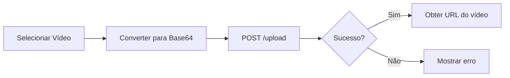
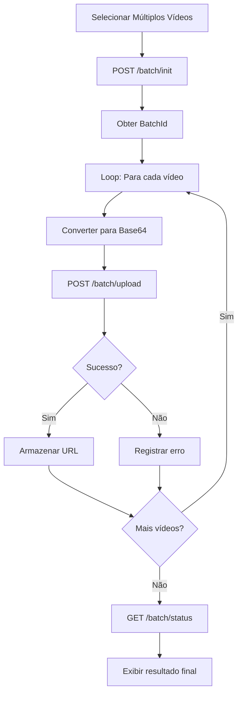

# Guia de Upload de Vídeos - Pregiato Management System

## 📋 Índice
- [Visão Geral](#visão-geral)
- [Problema Resolvido](#problema-resolvido)
- [Endpoints Disponíveis](#endpoints-disponíveis)
- [Fluxos de Upload](#fluxos-de-upload)
- [Exemplos de Código](#exemplos-de-código)
- [Limitações e Boas Práticas](#limitações-e-boas-práticas)

## 🎯 Visão Geral

Este sistema fornece uma solução robusta para upload de vídeos, com suporte para:
- ✅ Upload de vídeo único
- ✅ Upload sequencial de múltiplos vídeos
- ✅ Controle de progresso em tempo real
- ✅ Tratamento de erros individual por vídeo
- ✅ Validação de tamanho e formato

## 🔧 Problema Resolvido

**Problema Original:**
```
Erro: "Unexpected end of request content"
Causa: Tentativa de enviar múltiplos vídeos em Base64 numa única requisição, 
       excedendo limites do servidor.
```

**Solução Implementada:**
```
1. Sistema de upload em lote com processamento sequencial
2. Cada vídeo é enviado em uma requisição separada
3. Frontend aguarda resposta de cada vídeo antes de enviar o próximo
4. Controle de progresso e status centralizado
```

## 🚀 Endpoints Disponíveis

### 1. Upload de Vídeo Único
```http
POST /api/TrainingVideos/upload
Content-Type: application/json
```

**Uso:** Quando você tem apenas UM vídeo para enviar.

**Request Body:**
```json
{
  "fileName": "aula-01.mp4",
  "mimeType": "video/mp4",
  "fileSize": 52428800,
  "base64Data": "SGVsbG8gV29ybGQ=...",
  "courseTitle": "Curso de React",
  "lessonTitle": "Introdução ao React"
}
```

**Response:**
```json
{
  "success": true,
  "objectName": "Course/Curso-de-React/Introducao-ao-React.mp4",
  "videoUrl": "https://minio.example.com/videos/...",
  "presignedUrl": "https://...",
  "fileSize": 52428800,
  "mimeType": "video/mp4"
}
```

### 2. Iniciar Lote de Upload
```http
POST /api/TrainingVideos/batch/init
Content-Type: application/json
```

**Uso:** Primeira etapa quando você tem MÚLTIPLOS vídeos.

**Request Body:**
```json
{
  "totalVideos": 5,
  "courseName": "Curso de React"
}
```

**Response:**
```json
{
  "batchId": "550e8400-e29b-41d4-a716-446655440000",
  "totalVideos": 5,
  "createdAt": "2025-10-15T10:30:00Z",
  "message": "Lote iniciado com sucesso. Use o BatchId para fazer upload de cada vídeo individualmente."
}
```

### 3. Upload de Vídeo no Lote
```http
POST /api/TrainingVideos/batch/upload
Content-Type: application/json
```

**Uso:** Enviar cada vídeo individualmente dentro do lote.

**Request Body:**
```json
{
  "batchId": "550e8400-e29b-41d4-a716-446655440000",
  "videoIndex": 0,
  "videoData": {
    "fileName": "aula-01.mp4",
    "mimeType": "video/mp4",
    "fileSize": 52428800,
    "base64Data": "SGVsbG8gV29ybGQ=...",
    "courseTitle": "Curso de React",
    "lessonTitle": "Aula 01 - Introdução"
  }
}
```

**Response:** Mesmo formato do upload único

### 4. Verificar Status do Lote
```http
GET /api/TrainingVideos/batch/{batchId}/status
```

**Response:**
```json
{
  "batchId": "550e8400-e29b-41d4-a716-446655440000",
  "totalVideos": 5,
  "uploadedVideos": 3,
  "failedVideos": 1,
  "progressPercentage": 80.0,
  "isCompleted": false,
  "results": [...],
  "errors": ["Vídeo 2: Dados Base64 inválidos"],
  "createdAt": "2025-10-15T10:30:00Z",
  "completedAt": null
}
```

### 5. Limpar Lotes Antigos
```http
DELETE /api/TrainingVideos/batch/cleanup?olderThanHours=24
```

## 📊 Fluxos de Upload

### Fluxo 1: Upload Único (1 vídeo)



### Fluxo 2: Upload em Lote (múltiplos vídeos)



## 💡 Exemplos de Código

### Exemplo em React/TypeScript

Veja o arquivo completo: `batch-video-upload-example.ts`

**Uso básico:**

```typescript
import { VideoUploadManager } from './batch-video-upload-example';

// Criar instância do gerenciador
const uploadManager = new VideoUploadManager('http://localhost:5000');

// Configurar callbacks
uploadManager.setProgressCallback((progress, videoIndex, total) => {
  console.log(`Progresso: ${progress}% - Vídeo ${videoIndex + 1}/${total}`);
});

uploadManager.setVideoUploadedCallback((result, videoIndex) => {
  console.log(`Vídeo ${videoIndex + 1} URL:`, result.videoUrl);
});

// Upload múltiplo
const files = Array.from(fileInput.files);
const result = await uploadManager.uploadMultipleVideosSequentially(
  files,
  'Meu Curso',
  (file, index) => `Aula ${index + 1}`
);

console.log('Concluído!', result);
```

### Exemplo em JavaScript Vanilla

```javascript
async function uploadVideos(files) {
  // 1. Iniciar lote
  const initResponse = await fetch('http://localhost:5000/api/TrainingVideos/batch/init', {
    method: 'POST',
    headers: { 'Content-Type': 'application/json' },
    body: JSON.stringify({ totalVideos: files.length })
  });
  
  const { batchId } = await initResponse.json();
  
  // 2. Upload sequencial
  for (let i = 0; i < files.length; i++) {
    const file = files[i];
    
    // Converter para base64
    const base64 = await new Promise((resolve) => {
      const reader = new FileReader();
      reader.onload = () => resolve(reader.result.split(',')[1]);
      reader.readAsDataURL(file);
    });
    
    // Upload
    const uploadResponse = await fetch('http://localhost:5000/api/TrainingVideos/batch/upload', {
      method: 'POST',
      headers: { 'Content-Type': 'application/json' },
      body: JSON.stringify({
        batchId: batchId,
        videoIndex: i,
        videoData: {
          fileName: file.name,
          mimeType: file.type,
          fileSize: file.size,
          base64Data: base64,
          courseTitle: 'Meu Curso',
          lessonTitle: `Aula ${i + 1}`
        }
      })
    });
    
    const result = await uploadResponse.json();
    console.log(`Vídeo ${i + 1} enviado:`, result.videoUrl);
    
    // Pequeno delay entre uploads (opcional)
    await new Promise(resolve => setTimeout(resolve, 500));
  }
  
  // 3. Verificar status final
  const statusResponse = await fetch(`http://localhost:5000/api/TrainingVideos/batch/${batchId}/status`);
  const status = await statusResponse.json();
  
  console.log('Upload concluído:', status);
}
```

### Exemplo com Fetch API e Async/Await

```javascript
class SimpleVideoUploader {
  constructor(apiUrl) {
    this.apiUrl = apiUrl;
  }
  
  async uploadSingle(file, courseTitle, lessonTitle) {
    const base64 = await this.fileToBase64(file);
    
    const response = await fetch(`${this.apiUrl}/api/TrainingVideos/upload`, {
      method: 'POST',
      headers: { 'Content-Type': 'application/json' },
      body: JSON.stringify({
        fileName: file.name,
        mimeType: file.type,
        fileSize: file.size,
        base64Data: base64,
        courseTitle,
        lessonTitle
      })
    });
    
    if (!response.ok) {
      throw new Error(`Upload failed: ${response.statusText}`);
    }
    
    return await response.json();
  }
  
  async fileToBase64(file) {
    return new Promise((resolve, reject) => {
      const reader = new FileReader();
      reader.onload = () => {
        const base64 = reader.result.split(',')[1];
        resolve(base64);
      };
      reader.onerror = reject;
      reader.readAsDataURL(file);
    });
  }
}

// Uso
const uploader = new SimpleVideoUploader('http://localhost:5000');
const result = await uploader.uploadSingle(myFile, 'Curso', 'Aula 1');
console.log('URL:', result.videoUrl);
```

## ⚙️ Limitações e Boas Práticas

### Limitações do Servidor

```javascript
// Configurações atuais:
const LIMITS = {
  maxRequestBodySize: 524_288_000,    // 500MB por requisição
  maxVideoSize: 104_857_600,          // 100MB por vídeo
  maxVideosPerBatch: 50,              // Máximo de vídeos por lote
  requestTimeout: 300_000,            // 5 minutos
};
```

### Boas Práticas

1. **✅ Use upload em lote para múltiplos vídeos**
   ```javascript
   // ❌ NÃO FAÇA ISSO (múltiplos vídeos em uma requisição)
   const allVideosBase64 = videos.map(v => toBase64(v));
   await uploadAll(allVideosBase64);
   
   // ✅ FAÇA ISSO (um vídeo por vez)
   for (const video of videos) {
     await uploadSingle(video);
   }
   ```

2. **✅ Adicione delay entre uploads**
   ```javascript
   for (let i = 0; i < videos.length; i++) {
     await uploadVideo(videos[i]);
     
     // Delay de 500ms entre uploads
     if (i < videos.length - 1) {
       await new Promise(r => setTimeout(r, 500));
     }
   }
   ```

3. **✅ Implemente retry para falhas**
   ```javascript
   async function uploadWithRetry(file, maxRetries = 3) {
     for (let i = 0; i < maxRetries; i++) {
       try {
         return await uploadVideo(file);
       } catch (error) {
         if (i === maxRetries - 1) throw error;
         await new Promise(r => setTimeout(r, 2000 * (i + 1)));
       }
     }
   }
   ```

4. **✅ Valide tamanho antes de enviar**
   ```javascript
   const MAX_SIZE = 100 * 1024 * 1024; // 100MB
   
   if (file.size > MAX_SIZE) {
     alert(`Arquivo muito grande: ${file.size / 1024 / 1024}MB. Máximo: 100MB`);
     return;
   }
   ```

5. **✅ Mostre progresso ao usuário**
   ```javascript
   uploadManager.setProgressCallback((progress, current, total) => {
     updateProgressBar(progress);
     updateStatusText(`Uploading ${current}/${total}...`);
   });
   ```

6. **✅ Trate erros individualmente**
   ```javascript
   const results = {
     success: [],
     failed: []
   };
   
   for (const video of videos) {
     try {
       const result = await uploadVideo(video);
       results.success.push(result);
     } catch (error) {
       results.failed.push({ video, error });
     }
   }
   
   // Continuar mesmo se alguns falharem
   console.log(`Sucesso: ${results.success.length}, Falhas: ${results.failed.length}`);
   ```

### Otimizações Recomendadas

1. **Comprimir vídeos antes do upload**
   ```javascript
   // Use FFmpeg.js ou similar para comprimir
   const compressed = await compressVideo(originalFile, {
     maxSize: 50 * 1024 * 1024, // 50MB
     quality: 0.8
   });
   ```

2. **Upload em segundo plano**
   ```javascript
   // Use Web Workers para não bloquear a UI
   const worker = new Worker('upload-worker.js');
   worker.postMessage({ files, batchId });
   ```

3. **Cache de status**
   ```javascript
   // Salvar progresso no localStorage
   localStorage.setItem(`batch_${batchId}`, JSON.stringify(status));
   ```

## 🔍 Troubleshooting

### Erro: "Unexpected end of request content"
**Causa:** Vídeo muito grande ou conexão lenta  
**Solução:** Use upload em lote, reduza tamanho do vídeo

### Erro: "Dados Base64 inválidos"
**Causa:** Conversão incorreta para Base64  
**Solução:** Remova prefixo `data:video/mp4;base64,` antes de enviar

### Erro: "Request timeout"
**Causa:** Upload demorando mais de 5 minutos  
**Solução:** Comprima o vídeo ou divida em partes menores

### Erro: "Lote não encontrado"
**Causa:** BatchId inválido ou lote expirado  
**Solução:** Inicie um novo lote

## 📚 Recursos Adicionais

- **Arquivo de exemplo completo:** `batch-video-upload-example.ts`
- **Documentação da API:** Swagger UI em `/swagger`
- **Logs do servidor:** Verifique logs para debugging

## 🎉 Conclusão

Este sistema de upload sequencial resolve o problema de "Unexpected end of request content" ao:

1. ✅ Processar um vídeo por vez
2. ✅ Aguardar resposta antes de enviar o próximo
3. ✅ Fornecer feedback de progresso
4. ✅ Tratar erros individualmente
5. ✅ Manter controle centralizado do processo

**Use sempre o upload em lote para múltiplos vídeos!**
