# 📊 DIAGRAMAS DE SEQUÊNCIA - FLUXO DE ATENDIMENTO

## 🎯 OBJETIVO
Visualizar os fluxos de mensagens do sistema atual e comparar com a arquitetura proposta usando Meta API.

---

## 📤 DIAGRAMA 1: ENVIO DE MENSAGEM (FLUXO ATUAL)

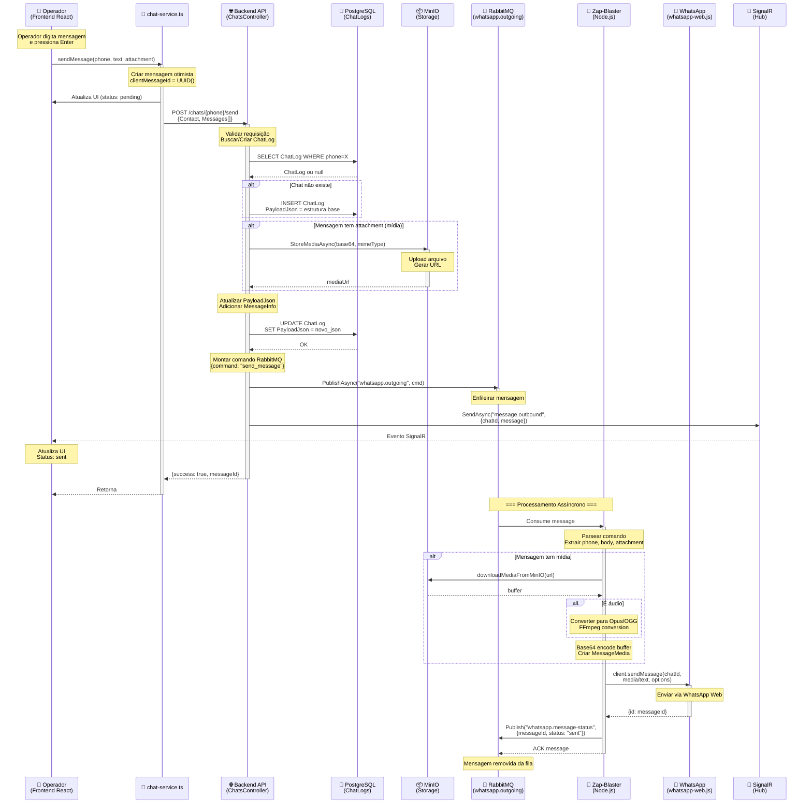

---

## 📥 DIAGRAMA 2: RECEBIMENTO DE MENSAGEM (FLUXO ATUAL)

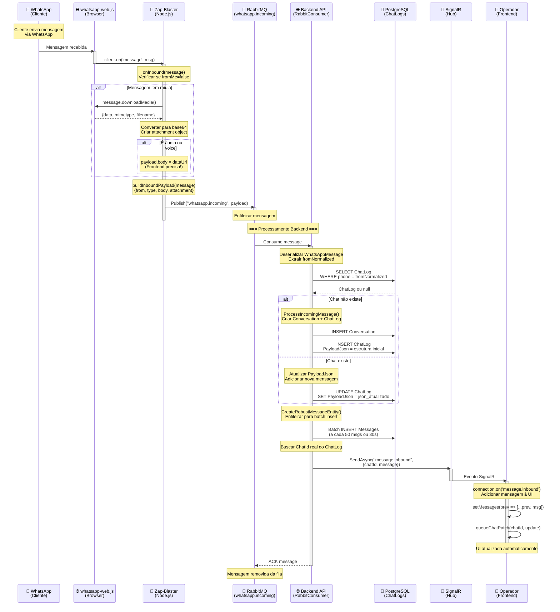

---

## 🆕 DIAGRAMA 3: ENVIO DE MENSAGEM (NOVA ARQUITETURA META API)

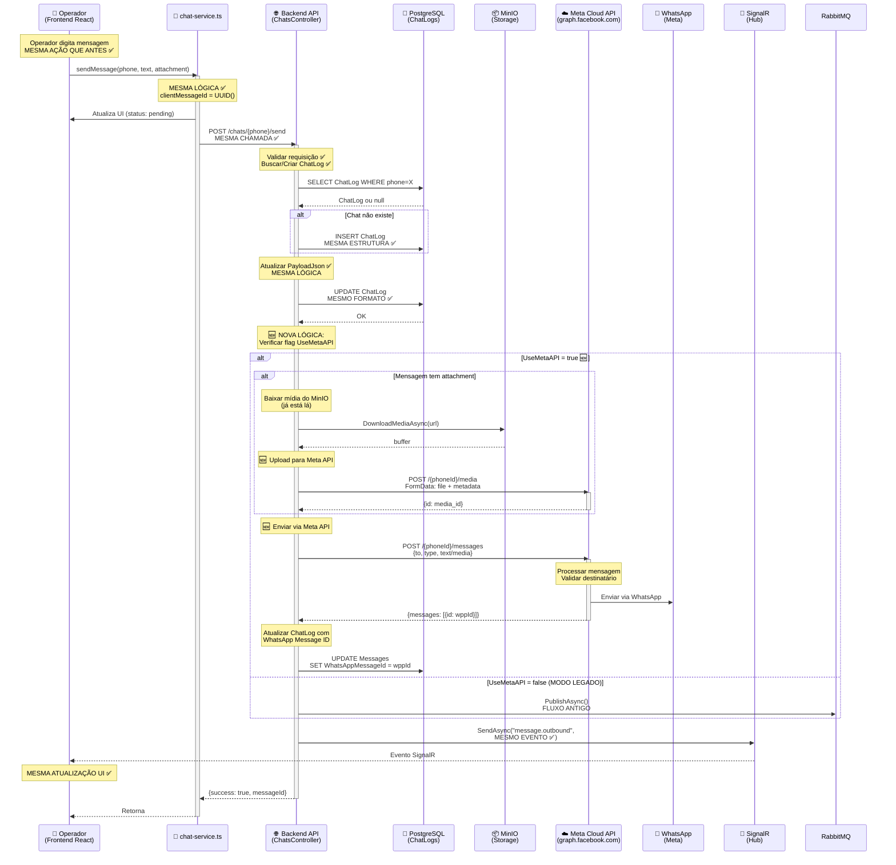

---

## 🆕 DIAGRAMA 4: RECEBIMENTO DE MENSAGEM (NOVA ARQUITETURA META API)

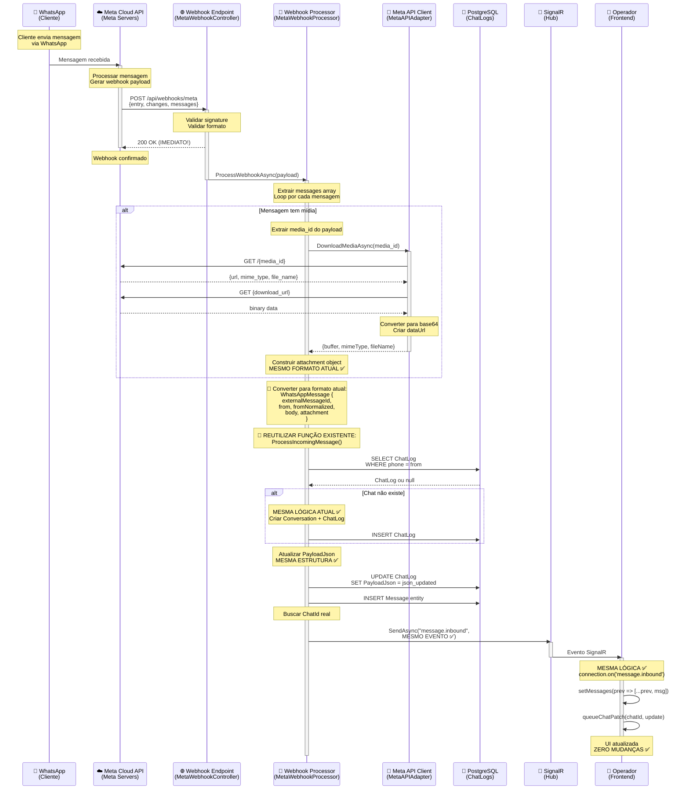

---

## 🔄 DIAGRAMA 5: STATUS UPDATE DE MENSAGEM (META API)

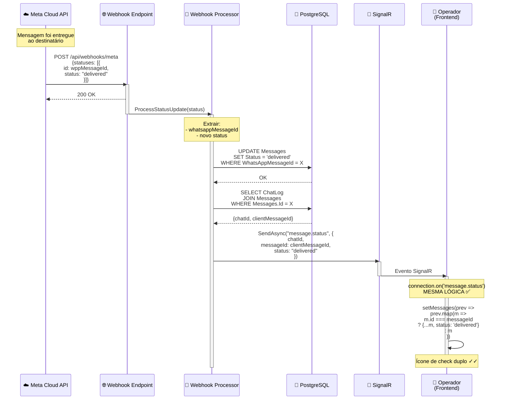

---

## 🔀 DIAGRAMA 6: COMPARAÇÃO DUAL MODE

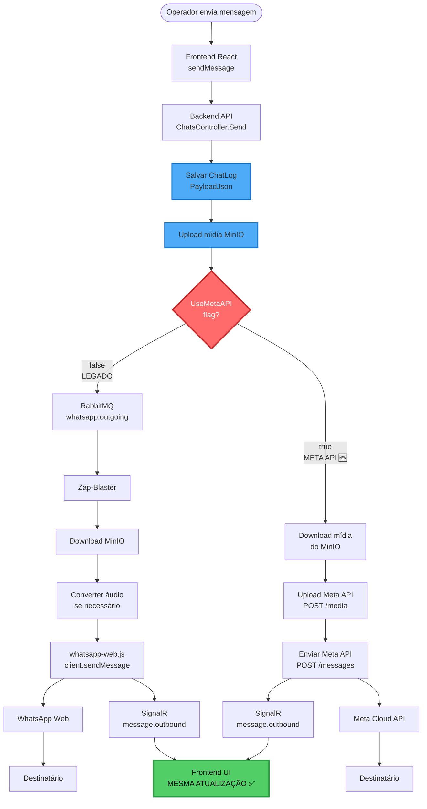

---

## 🎯 DIAGRAMA 7: MAPEAMENTO DE RESPONSABILIDADES

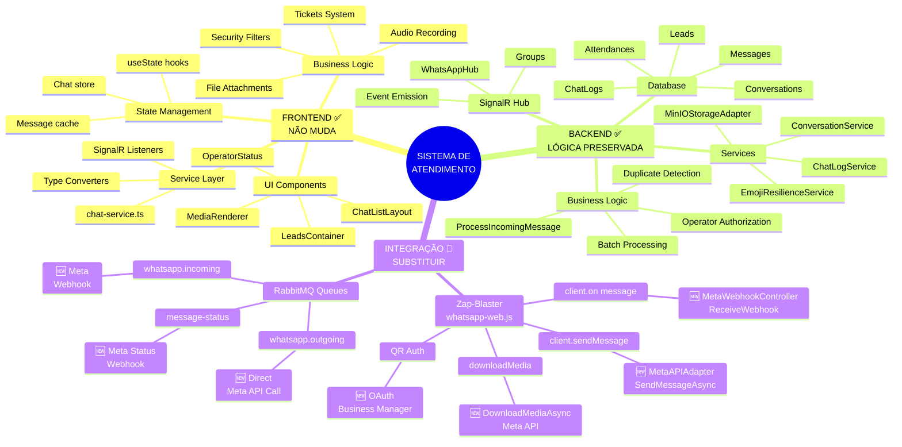

---

## 📊 DIAGRAMA 8: FLUXO DE DADOS - ESTRUTURAS

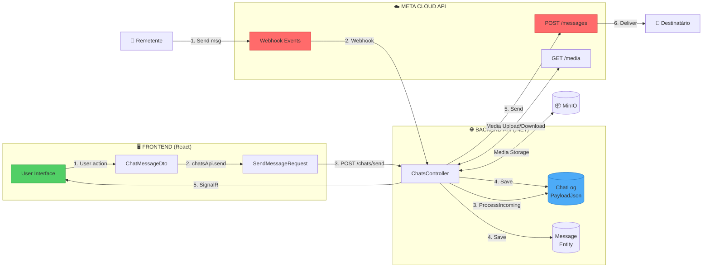

---

## 🔐 DIAGRAMA 9: AUTENTICAÇÃO - ANTES E DEPOIS

```mermaid
flowchart TB
    subgraph ANTES["⚡ ANTES - Zap-Blaster (whatsapp-web.js)"]
        A1[Operador acessa sistema]
        A2[Backend solicita QR via RabbitMQ]
        A3[Zap-Blaster gera QR]
        A4[QR exibido no frontend]
        A5[Operador escaneia com celular]
        A6[WhatsApp Web autentica]
        A7[Sessão salva localmente]
        A8[✅ Sistema conectado]
        
        A1 --> A2 --> A3 --> A4 --> A5 --> A6 --> A7 --> A8
    end
    
    subgraph DEPOIS["🆕 DEPOIS - Meta Cloud API"]
        D1[Admin acessa Meta Business Manager]
        D2[Criar WhatsApp Business Account]
        D3[Verificar número de telefone]
        D4[Gerar System User Token permanente]
        D5[Configurar webhook URL]
        D6[Adicionar tokens no backend]
        D7[✅ Sistema conectado]
        
        D1 --> D2 --> D3 --> D4 --> D5 --> D6 --> D7
        
        Note1[📝 Nota: Configuração única<br/>Token não expira<br/>Múltiplos números permitidos]
        D7 -.-> Note1
    end
    
    style A8 fill:#51cf66,stroke:#2f9e44
    style D7 fill:#51cf66,stroke:#2f9e44
    style Note1 fill:#fff3bf,stroke:#f59f00
```

---

## 📈 DIAGRAMA 10: ESCALABILIDADE

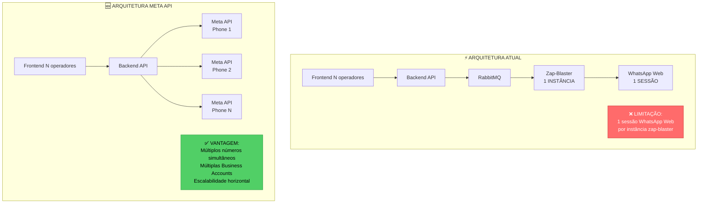

---

## 🎨 DIAGRAMA 11: PRESERVAÇÃO DA UI

```mermaid
flowchart LR
    subgraph UI["🖥️ INTERFACE DO USUÁRIO - ZERO MUDANÇAS"]
        CHAT[Lista de Chats]
        MSGS[Área de Mensagens]
        COMP[Composer<br/>Digite aqui...]
        MEDIA[MediaRenderer<br/>Áudio/Imagem/Vídeo]
        LEADS[Container de Leads]
        TICKET[Sistema de Tickets]
        STATUS[Status Cards<br/>Bot + Operador]
    end
    
    subgraph EVENTS["🔔 EVENTOS SIGNALR - MESMOS"]
        E1[message.inbound]
        E2[message.outbound]
        E3[message.status]
        E4[chat.created]
        E5[chat.updated]
        E6[presence.typing]
    end
    
    subgraph BACKEND["🔧 BACKEND - NOVA FONTE DE DADOS"]
        OLD[❌ Zap-Blaster<br/>whatsapp-web.js]
        NEW[✅ Meta Cloud API<br/>Webhooks]
    end
    
    BACKEND --> EVENTS
    EVENTS --> UI
    
    OLD -.->|REMOVER| EVENTS
    NEW ==>|ADICIONAR| EVENTS
    
    NOTE[📝 FRONTEND NÃO SABE<br/>A DIFERENÇA!<br/>Mesmos eventos = Mesma UI]
    
    EVENTS -.-> NOTE
    
    style UI fill:#51cf66,stroke:#2f9e44
    style EVENTS fill:#4dabf7,stroke:#1971c2
    style OLD fill:#ff6b6b,stroke:#c92a2a,color:#fff
    style NEW fill:#51cf66,stroke:#2f9e44
    style NOTE fill:#fff3bf,stroke:#f59f00
```

---

## 🔧 DIAGRAMA 12: PROCESSAMENTO DE ÁUDIO - COMPARAÇÃO

```mermaid
sequenceDiagram
    participant U as Operador
    participant F as Frontend
    participant B as Backend
    participant S as Storage
    participant W as WhatsApp
    
    Note over U,W: === FLUXO ATUAL (Zap-Blaster) ===
    
    U->>F: Gravar áudio (WebM/Opus)
    F->>F: Convert to base64
    F->>B: POST /send<br/>{dataUrl: "data:audio/webm;base64,..."}
    B->>S: Upload para MinIO<br/>(armazena WebM)
    B->>RabbitMQ: {attachment: {mediaUrl}}
    RabbitMQ->>Zap: Consome fila
    Zap->>S: Download WebM
    Zap->>Zap: FFmpeg: WebM → Opus/OGG<br/>(-c:a libopus -b:a 16k)
    Zap->>W: sendMessage(OGG buffer)
    W->>Dest[Cliente]: 🎵 Áudio reproduzível
    
    Note over U,W: === NOVO FLUXO (Meta API) ===
    
    U->>F: Gravar áudio (WebM/Opus)<br/>MESMA GRAVAÇÃO ✅
    F->>F: Convert to base64<br/>MESMA CONVERSÃO ✅
    F->>B: POST /send<br/>MESMA CHAMADA ✅
    B->>S: Upload para MinIO<br/>MESMO UPLOAD ✅
    
    B->>B: 🆕 Download do MinIO
    B->>B: 🆕 Verificar formato:<br/>- WebM/Opus → Converter para OGG<br/>- OGG/Opus → Usar direto<br/>- MP3/outros → Converter
    B->>Meta[Meta API]: 🆕 POST /media<br/>(upload OGG/Opus)
    Meta-->>B: {id: media_id}
    B->>Meta: 🆕 POST /messages<br/>{type: "audio", audio: {id}}
    Meta->>W: Enviar via Cloud API
    W->>Dest: 🎵 Áudio reproduzível
    
    style F fill:#51cf66,stroke:#2f9e44
    style Meta fill:#ff6b6b,stroke:#c92a2a,color:#fff
```

---

## 💡 DIAGRAMA 13: PONTOS DE INTEGRAÇÃO

```mermaid
graph TB
    subgraph MANTEM["✅ MANTER - NÃO ALTERAR"]
        direction TB
        M1[Frontend UI/UX]
        M2[SignalR Events]
        M3[ChatLog PayloadJson]
        M4[Leads System]
        M5[Tickets System]
        M6[Attendances]
        M7[MinIO Storage]
        M8[Operator Auth]
        M9[Message History]
        M10[Business Logic]
    end
    
    subgraph ALTERA["🔴 ALTERAR - SUBSTITUIR"]
        direction TB
        A1[zap-blaster/zap.js]
        A2[whatsapp-web.js]
        A3[RabbitMQ outgoing queue]
        A4[RabbitMQ incoming queue]
        A5[QR Code generation]
        A6[Session persistence]
    end
    
    subgraph ADICIONA["🆕 ADICIONAR - NOVO"]
        direction TB
        N1[MetaAPIAdapter]
        N2[MetaWebhookController]
        N3[MetaWebhookProcessor]
        N4[Meta OAuth Config]
        N5[Webhook Verification]
        N6[Rate Limiting Meta]
        N7[Media Upload Meta]
        N8[Status Webhooks]
    end
    
    MANTEM -.->|Integra com| ADICIONA
    ALTERA -->|Substituído por| ADICIONA
    
    style MANTEM fill:#51cf66,stroke:#2f9e44
    style ALTERA fill:#ff6b6b,stroke:#c92a2a,color:#fff
    style ADICIONA fill:#4dabf7,stroke:#1971c2
```

---

## 🎯 RESUMO VISUAL

### **PRINCÍPIO FUNDAMENTAL:**

```
┌───────────────────────────────────────────────────────────────┐
│                                                               │
│  "ALTERAR APENAS A CAMADA DE TRANSPORTE,                     │
│   PRESERVAR TODA A LÓGICA DE NEGÓCIO"                        │
│                                                               │
│  Frontend ──► Backend ──► [CAMADA DE TRANSPORTE] ──► WhatsApp│
│     ✅           ✅              🔄 ALTERAR                    │
│  PRESERVA    PRESERVA         Zap-Blaster → Meta API         │
│                                                               │
└───────────────────────────────────────────────────────────────┘
```

### **ONDE ESTÁ CADA COISA:**

```
📁 ESTRUTURA DO PROJETO
│
├── 🖥️ front/
│   ├── src/pages/atendimento/
│   │   └── index.tsx ✅ NÃO ALTERAR
│   ├── src/services/
│   │   └── chat-service.ts ✅ NÃO ALTERAR (interface)
│   └── src/components/whatsapp/
│       └── MediaRenderer.tsx ✅ NÃO ALTERAR
│
├── 🌐 back/
│   ├── Pregiato.API/
│   │   ├── Controllers/
│   │   │   ├── ChatsController.cs 🔄 MODIFICAR (adicionar Meta API)
│   │   │   └── MetaWebhookController.cs 🆕 CRIAR
│   │   ├── Services/
│   │   │   └── RabbitBackgroundService.cs 🔄 MODIFICAR (opcional)
│   │   └── Hubs/
│   │       └── WhatsAppHub.cs ✅ NÃO ALTERAR
│   │
│   ├── Pregiato.Application/
│   │   └── Services/
│   │       ├── ChatLogService.cs ✅ NÃO ALTERAR
│   │       └── MetaWebhookProcessor.cs 🆕 CRIAR
│   │
│   └── Pregiato.Infrastructure/
│       └── Adapters/
│           ├── MinIOStorageAdapter.cs ✅ NÃO ALTERAR
│           └── MetaAPIAdapter.cs 🆕 CRIAR
│
└── 🤖 zap-blaster-projeto/
    └── zap.js 🔴 DEPRECAR (manter backup)

LEGENDA:
✅ NÃO ALTERAR - Funciona perfeitamente, preservar
🔄 MODIFICAR - Adicionar suporte dual mode
🆕 CRIAR - Novos componentes para Meta API
🔴 DEPRECAR - Será substituído gradualmente
```

---

## 📋 CHECKLIST DE COMPATIBILIDADE

### ✅ **GARANTIR COMPATIBILIDADE TOTAL:**

- [ ] Frontend recebe mesmos eventos SignalR
- [ ] Estrutura de `attachment` permanece igual
- [ ] Tipos de mensagem mapeados corretamente
- [ ] Status de mensagens mapeados corretamente
- [ ] ChatLog.PayloadJson mantém mesma estrutura
- [ ] MinIO continua sendo usado para storage
- [ ] Sistema de leads funciona igual
- [ ] Sistema de tickets funciona igual
- [ ] Autorização de operadores funciona igual
- [ ] Histórico de mensagens funciona igual
- [ ] Gravação de áudio funciona igual
- [ ] Envio de anexos funciona igual
- [ ] Renderização de mídia funciona igual

### 🆕 **NOVOS REQUISITOS META API:**

- [ ] Configurar Meta Business Account
- [ ] Verificar número de telefone com Meta
- [ ] Obter Phone Number ID
- [ ] Gerar Access Token permanente
- [ ] Configurar webhook na Meta Business Manager
- [ ] Implementar endpoint de verificação webhook
- [ ] Implementar endpoint de recebimento webhook
- [ ] Validar assinatura dos webhooks (security)
- [ ] Implementar rate limiting
- [ ] Implementar retry específico Meta
- [ ] Monitorar quotas e limites
- [ ] Configurar templates (para mensagens proativas)

---

**Documento gerado em:** 2025-10-17  
**Versão:** 1.0  
**Tipo:** Diagramas de Sequência e Fluxo

